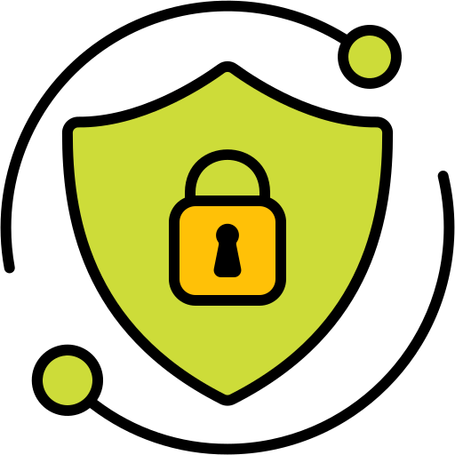

# Digital-Security-Ops-Mastery

Practical guides for secure, privacy-conscious smartphone and PC setups: Android without Google, child-safe devices, Nextcloud, Linux automation, encrypted backups, and AI agents.

## Documentation & Topics

-  [Nextcloud](docs/nextcloud/index.md) – Guidance for setting up and synchronizing files, contacts, calendars, and notes.
-  [Android & mobile](docs/android/index.md) – De-Googled Android, child-proof phones, and backup/restore strategies.
-  [Linux & automation](docs/linux/index.md) – Kubuntu setup, NAS mounts, encrypted sync, media processing, DVD playback, and map data.
-  [AI & agents](docs/ai/index.md) – OpenCode setup, model providers, free models, MCP, and agentic workflows.
-  [Credits and licenses](docs/credits.md)

The full rendered documentation is available at [Read the Docs](https://digital-security-ops-mastery.readthedocs.io/en/latest/).

## Contributing

Issues and pull requests are welcome. Keep documentation in English and follow the repository guidelines in [AGENTS.md](AGENTS.md).
